# Lab 01 — Dynamic Routing Using RIPv2

## 1. Objective & Problem Statement

### Objective

Configure and verify dynamic routing between three interconnected LANs using Routing Information Protocol version 2 (RIPv2) in Cisco Packet Tracer.

This lab demonstrates IPv4 addressing, router interface configuration, dynamic route exchange, and end-to-end connectivity verification.

### Problem Statement

The network consists of three separate LANs connected through three routers: Jana (R1), Badr (R2), and Alwezainani (R3).

By default, each router knows only its directly connected networks. Without static routes or a dynamic routing protocol, routers cannot forward traffic to remote LANs for which they have no routing information.

**The challenge:** Enable communication between all three LANs without manually configuring static routes for every remote network.

### Proposed Solution

Implement RIPv2 on all three routers to dynamically advertise connected networks and learn routes to remote LANs.

RIPv2 was selected as the routing protocol required for this lab. It supports classless routing and uses hop count as its routing metric.

### Lab Objectives

- Configure IPv4 addresses and subnet masks.
- Establish two point-to-point serial WAN connections.
- Configure RIPv2 on three Cisco routers.
- Disable automatic route summarization.
- Configure passive LAN interfaces.
- Verify interface status and dynamically learned routes.
- Test end-to-end network connectivity.

---

## 2. Network Topology & IP Addressing

### Network Topology

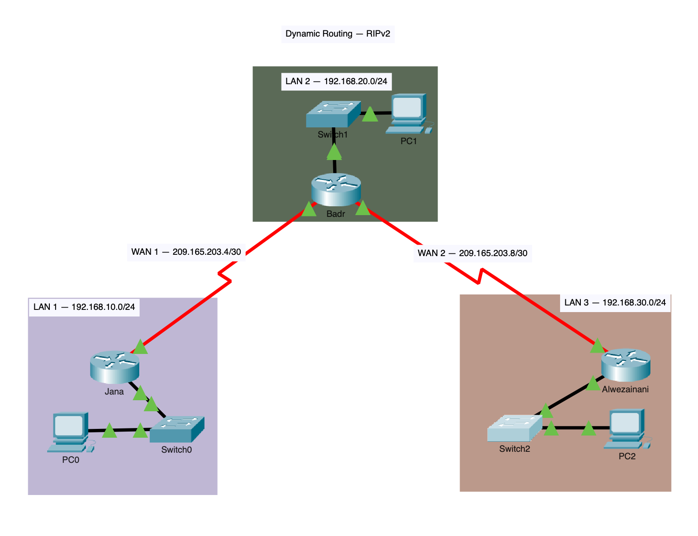

### Network Components

| Device | Model | Quantity |
|---|---|---|
| Router | Cisco 1941 | 3 |
| Switch | Cisco 2960 | 3 |
| PC | PC-PT | 3 |

The topology consists of three LANs connected through two serial WAN links.

### Network Addressing

| Network | Address | Purpose |
|---|---|---|
| LAN 1 | 192.168.10.0/24 | Jana LAN |
| LAN 2 | 192.168.20.0/24 | Badr LAN |
| LAN 3 | 192.168.30.0/24 | Alwezainani LAN |
| WAN 1 | 209.165.203.4/30 | Jana–Badr |
| WAN 2 | 209.165.203.8/30 | Badr–Alwezainani |

### Router Interfaces

| Router | Interface | IP Address | Subnet Mask |
|---|---|---|---|
| Jana (R1) | G0/0 | 192.168.10.1 | 255.255.255.0 |
| Jana (R1) | S0/0/0 | 209.165.203.5 | 255.255.255.252 |
| Badr (R2) | G0/0 | 192.168.20.1 | 255.255.255.0 |
| Badr (R2) | S0/0/0 | 209.165.203.6 | 255.255.255.252 |
| Badr (R2) | S0/0/1 | 209.165.203.9 | 255.255.255.252 |
| Alwezainani (R3) | G0/0 | 192.168.30.1 | 255.255.255.0 |
| Alwezainani (R3) | S0/0/0 | 209.165.203.10 | 255.255.255.252 |

### PC Configuration

| Device | IP Address | Subnet Mask | Default Gateway |
|---|---|---|---|
| PC0 | 192.168.10.100 | 255.255.255.0 | 192.168.10.1 |
| PC1 | 192.168.20.100 | 255.255.255.0 | 192.168.20.1 |
| PC2 | 192.168.30.100 | 255.255.255.0 | 192.168.30.1 |

---

## 3. Configuration

### Configuration Overview

RIPv2 was configured on all three routers using the following settings:

- RIP version 2
- Automatic route summarization disabled
- LAN and WAN network advertisements
- Passive GigabitEthernet0/0 interfaces
- Configuration saved to startup configuration

### Jana (R1)

```text
router rip
 version 2
 no auto-summary
 network 192.168.10.0
 network 209.165.203.4
 passive-interface GigabitEthernet0/0
```

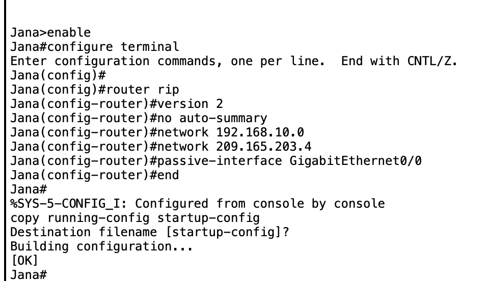

### Badr (R2)

```text
router rip
 version 2
 no auto-summary
 network 192.168.20.0
 network 209.165.203.4
 network 209.165.203.8
 passive-interface GigabitEthernet0/0
```

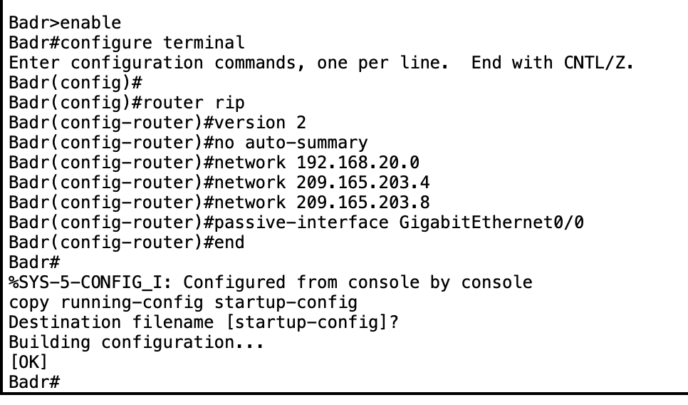

### Alwezainani (R3)

```text
router rip
 version 2
 no auto-summary
 network 192.168.30.0
 network 209.165.203.8
 passive-interface GigabitEthernet0/0
```

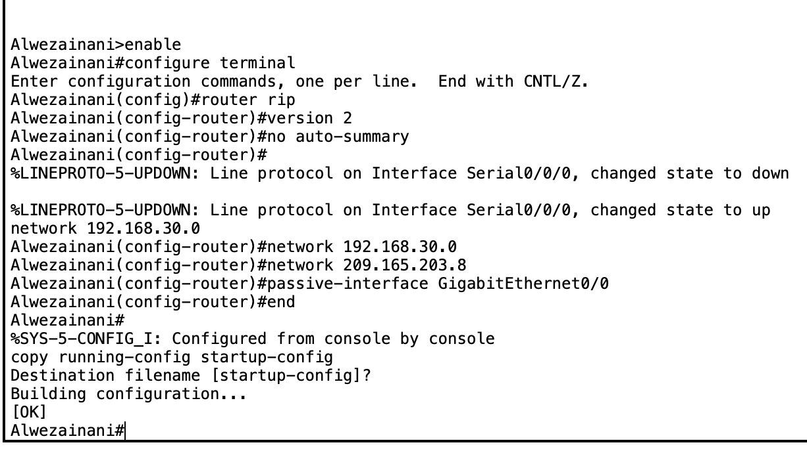

**Cisco IOS Note:** RIP `network` statements are classful. Cisco IOS normalizes the WAN network statements to `209.165.203.0` in the running configuration.

### Configuration Explanation

| Command | Purpose |
|---|---|
| `router rip` | Enables the RIP routing process |
| `version 2` | Uses RIPv2 for routing updates |
| `no auto-summary` | Disables automatic classful route summarization |
| `network` | Enables RIP on matching interfaces and advertises their networks |
| `passive-interface GigabitEthernet0/0` | Prevents RIP updates from being sent through the LAN interface |

---

## 4. Verification & Results

### 4.1 Interface Status

The `show ip interface brief` command was used to verify that the configured LAN and WAN interfaces were operational.

All required interfaces were confirmed as `up/up`.

**Jana (R1)**

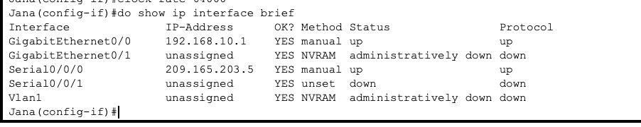

**Badr (R2)**

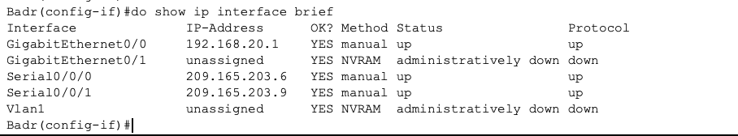

**Alwezainani (R3)**

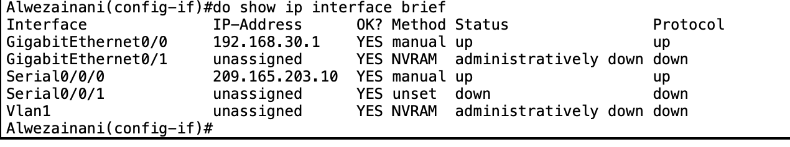

### 4.2 Routing Table Verification

The `show ip route` command confirmed that the routers learned remote LAN networks dynamically through RIP.

Routes marked with `R` indicate RIP-learned routes.

**Jana (R1)**

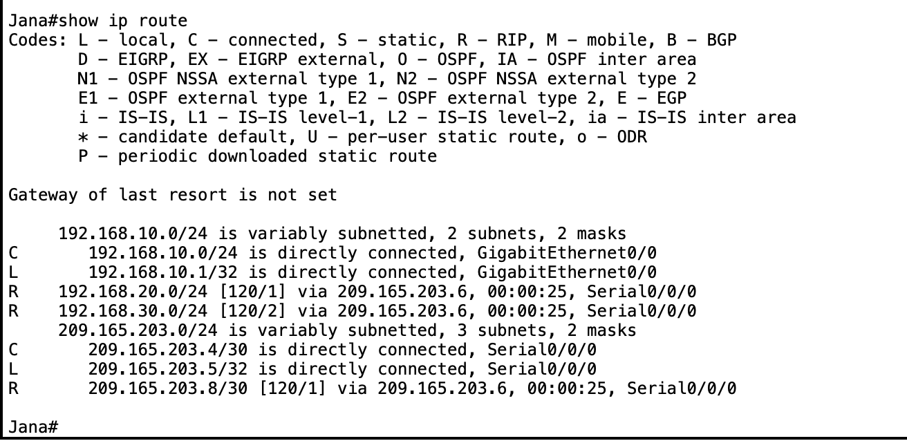

**Badr (R2)**

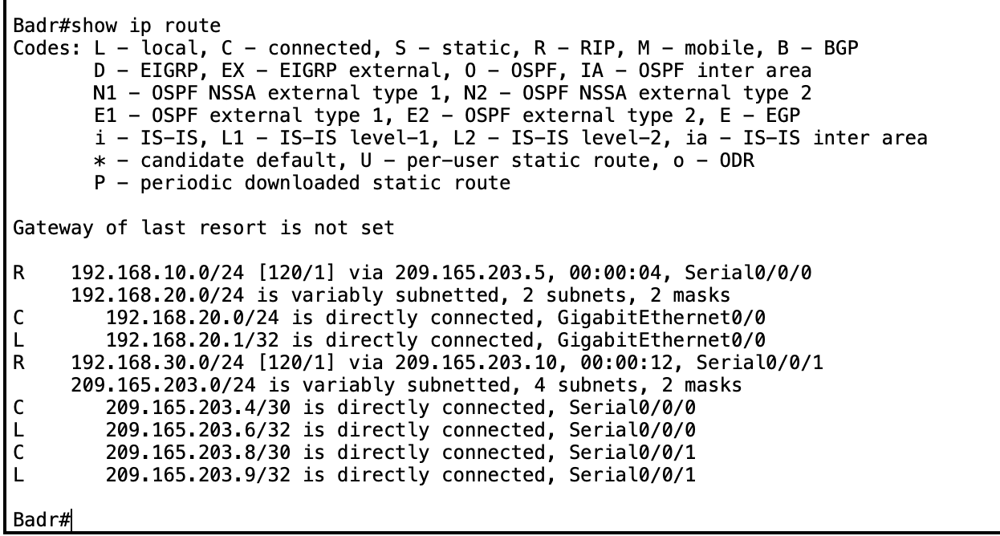

**Alwezainani (R3)**

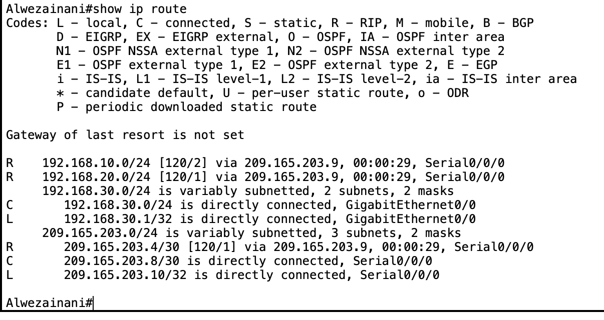

### Routing Table Findings

- Jana learned routes to LAN 2 and LAN 3.
- Badr learned routes to LAN 1 and LAN 3.
- Alwezainani learned routes to LAN 1 and LAN 2.
- RIP selected routes based on hop count.
- Traffic between Jana and Alwezainani traverses Badr.

### 4.3 RIP Protocol Verification

The `show ip protocols` command was used to verify:

- RIPv2 was active.
- Routing updates used RIP version 2.
- Automatic route summarization was disabled.
- GigabitEthernet0/0 was configured as a passive interface.
- Routing information was received from neighboring routers.

**Jana (R1)**

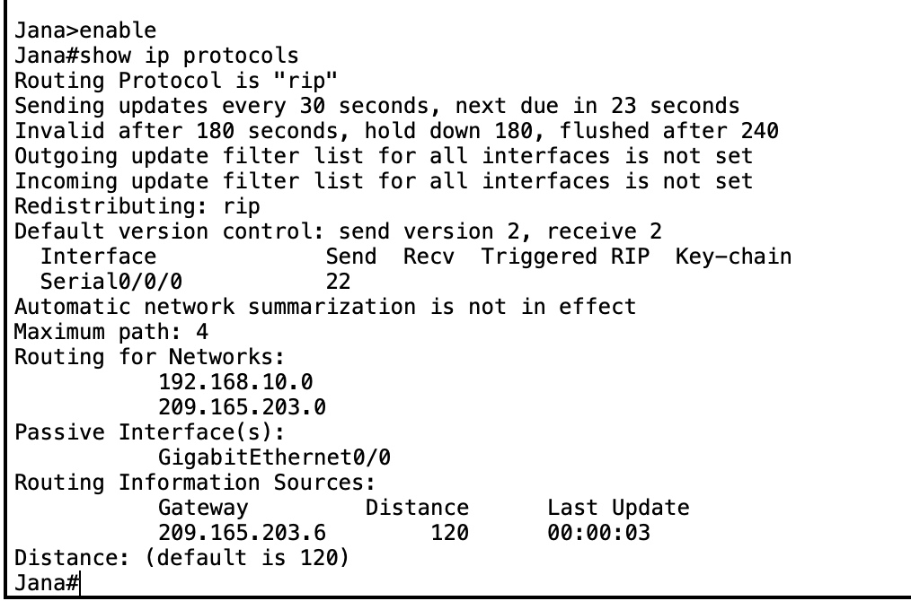

**Badr (R2)**

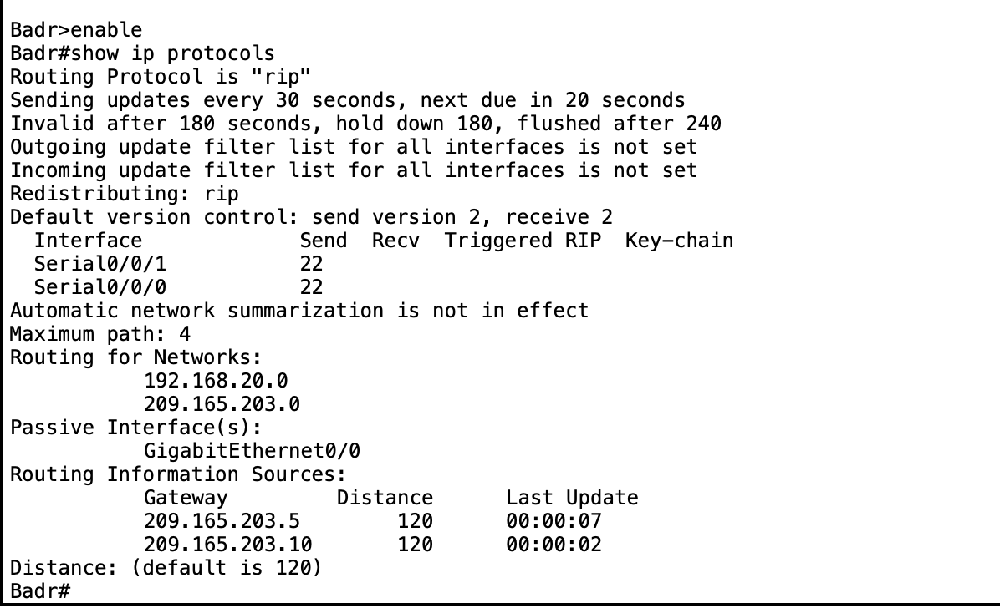

**Alwezainani (R3)**

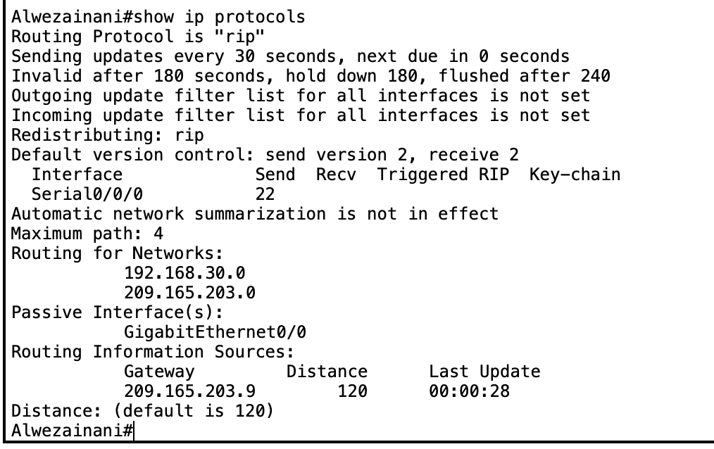

### 4.4 End-to-End Connectivity Testing

Connectivity was tested between PC0 and PC2 in both directions.

**Test 1 — PC0 to PC2**

```text
ping 192.168.30.100

Packets: Sent = 4, Received = 4, Lost = 0 (0% loss)
```

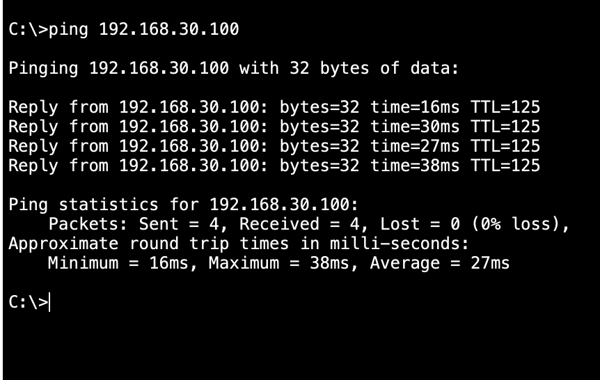

**Test 2 — PC2 to PC0**

```text
ping 192.168.10.100

Packets: Sent = 4, Received = 4, Lost = 0 (0% loss)
```

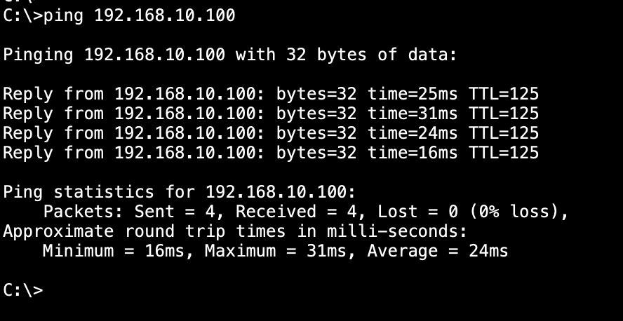

### Verification Summary

| Verification Test | Result |
|---|---|
| Router interface status | Passed |
| RIPv2 configuration | Passed |
| Dynamic route learning | Passed |
| RIP protocol verification | Passed |
| PC0 → PC2 connectivity | Passed — 0% packet loss |
| PC2 → PC0 connectivity | Passed — 0% packet loss |

---

## 5. Troubleshooting

### Issue 1 — Serial Interface Module Compatibility

**Problem:** The required serial interface was unavailable when an incompatible router module was selected.

**Cause:** The installed module did not provide the required serial interfaces.

**Solution:** Replaced the incompatible module with the HWIC-2T serial interface module.

**Result:** The required serial interfaces became available for WAN configuration.

### Issue 2 — Initial Ping Packet Loss

**Problem:** The initial connectivity test returned three successful replies out of four packets.

**Observation:** The first test showed 25% packet loss.

**Action Taken:** Repeated the connectivity test after the network had initialized.

**Result:** The subsequent test returned four successful replies out of four packets, with 0% packet loss.

**Possible Explanation:** Initial ARP resolution may have contributed to the first lost packet. The exact cause was not independently confirmed.

### Troubleshooting Outcome

The final verification confirmed that all required router interfaces were operational, RIP routes were learned successfully, and end-to-end connectivity was established.

---

## 6. Lessons Learned

This lab provided practical experience in the following areas:

### Network Configuration

- Configuring IPv4 addresses and subnet masks.
- Assigning default gateways to end devices.
- Establishing serial point-to-point WAN connections.
- Configuring Cisco router interfaces through the CLI.

### Dynamic Routing

- Understanding directly connected and remote networks.
- Configuring RIPv2 across multiple routers.
- Understanding classless routing and automatic summarization.
- Using passive interfaces to control RIP update transmission.
- Interpreting RIP hop counts and routing table entries.

### Verification & Troubleshooting

- Using `show ip interface brief` to verify interface status.
- Using `show ip route` to identify dynamically learned routes.
- Using `show ip protocols` to verify routing protocol settings.
- Testing end-to-end connectivity with ICMP ping.
- Investigating connectivity issues and validating corrective actions.

### Technical Documentation

- Organizing network configuration evidence.
- Documenting network topology and IP addressing.
- Recording verification results.
- Presenting troubleshooting findings in a structured technical report.
- Preparing networking projects for a GitHub portfolio.

---

## 7. Conclusion

The three LANs were successfully interconnected using RIPv2.

All three routers exchanged routing information and learned routes to remote networks. The final connectivity tests confirmed successful communication between PC0 and PC2 in both directions, with 0% packet loss.

The lab demonstrates the implementation of dynamic routing and the importance of configuration verification, troubleshooting, and technical documentation.

---

## 8. Project File

[Open Cisco Packet Tracer Configuration](./configuration.pkt)
