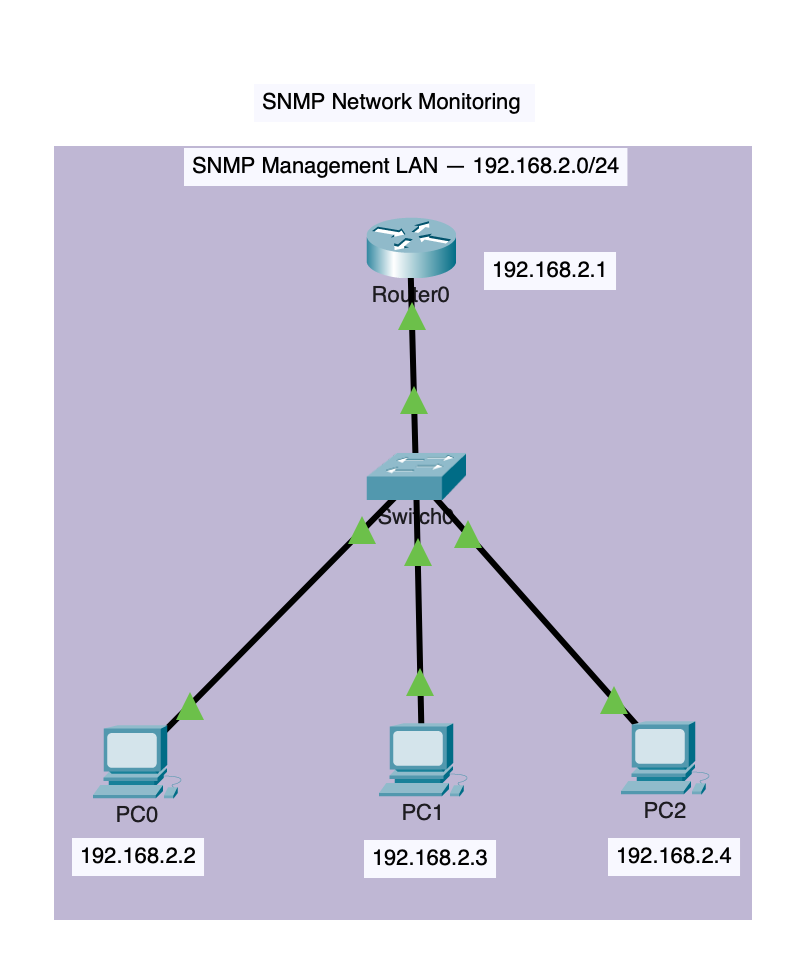
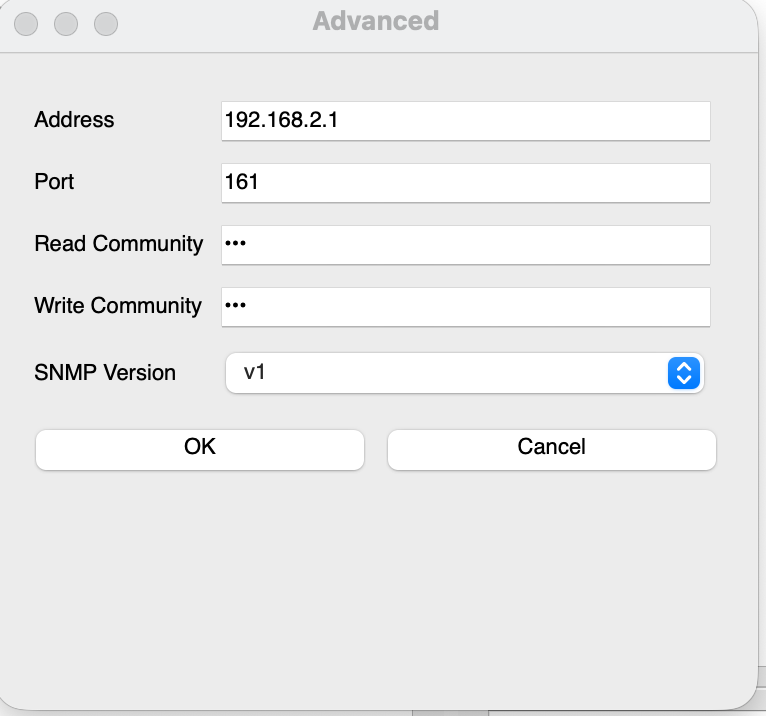
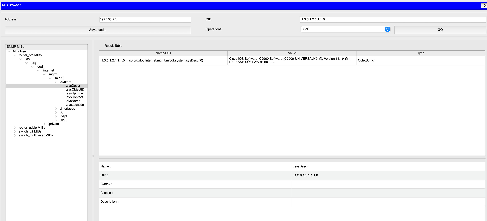
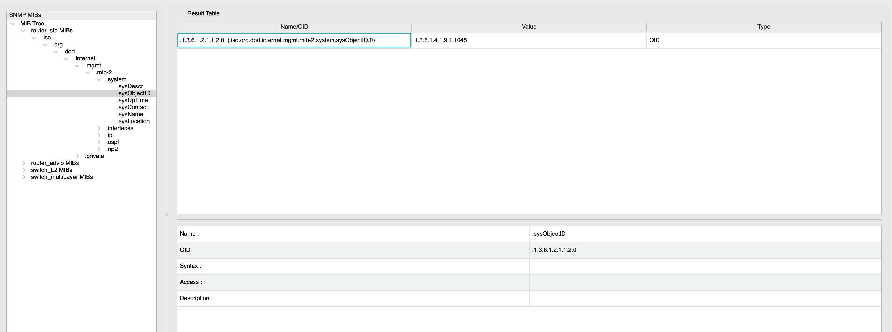
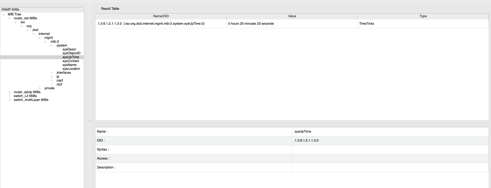
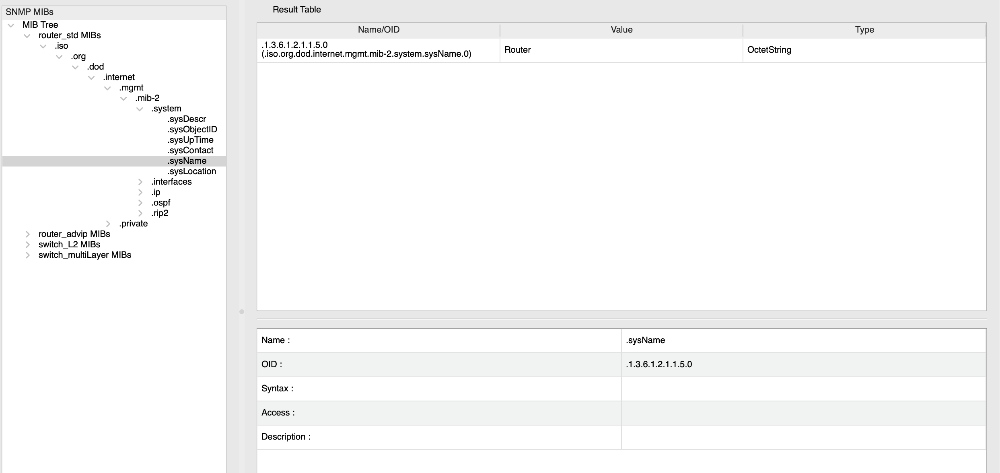
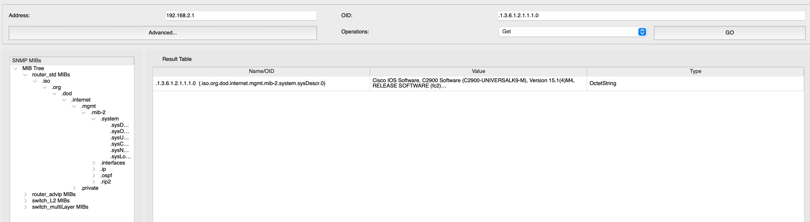
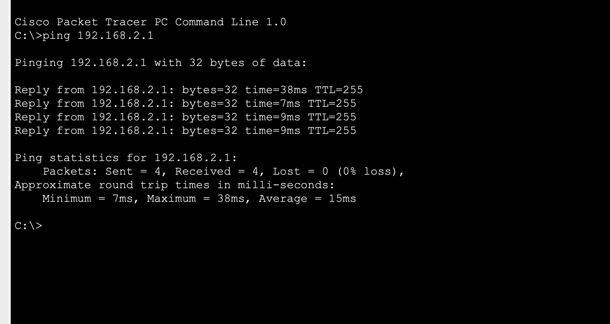
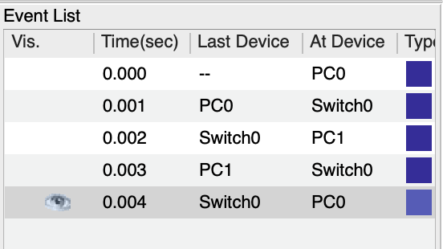
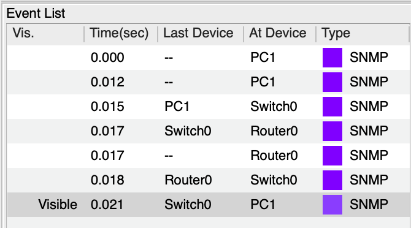

# SNMP Network Monitoring

## 1. Objective & Problem Statement

### Objective

Configure and verify Simple Network Management Protocol (SNMP) monitoring of a Cisco router using the MIB Browser in Cisco Packet Tracer.

This lab demonstrates IPv4 addressing, SNMP agent configuration, management information retrieval through MIB-II objects, and verification of ICMP and SNMP communication.

### Problem Statement

A network administrator needs to retrieve device information from a router without repeatedly accessing its command-line interface.

IP connectivity alone does not provide management details such as the device description, system name, object identifier, or uptime.

**The challenge:** Enable a management workstation to query a router for operational information and verify that the requests and responses traverse the network successfully.

### Proposed Solution

Configure Router0 as an SNMP agent and use the MIB Browser on PC1 as the SNMP manager. Retrieve standard MIB-II system objects with SNMP GET operations and inspect protocol exchanges using Packet Tracer Simulation Mode.

SNMPv1 was used in the lab environment. Its community-based authentication is not suitable for secure production monitoring; SNMPv3 is preferable in production.

### Lab Objectives

- Configure IPv4 addresses and default gateways on the LAN.
- Verify the router's active network interface.
- Configure an SNMP community string on Router0.
- Set the MIB Browser's target address, UDP port, and SNMP version.
- Retrieve router information through standard system OIDs.
- Verify ICMP connectivity and observe packet exchanges in Simulation Mode.

---

## 2. Network Topology & IP Addressing

### Network Topology



### Network Components

| Device | Model | Quantity |
|---|---|---|
| Router | Cisco 2900-series | 1 |
| Switch | Cisco switch | 1 |
| PC | PC-PT | 3 |

The topology consists of a single management LAN. Router0 is connected to Switch0, which connects PC0, PC1, and PC2. PC1 serves as the SNMP management workstation.

### Network Addressing

| Network | Address | Purpose |
|---|---|---|
| Management LAN | 192.168.2.0/24 | Router and workstation connectivity |

### Router Interfaces

| Router | Interface | IP Address | Subnet Mask | Status |
|---|---|---|---|---|
| Router0 | GigabitEthernet0/0 | 192.168.2.1 | 255.255.255.0 | up/up |

### PC Configuration

| Device | IP Address | Subnet Mask | Default Gateway |
|---|---|---|---|
| PC0 | 192.168.2.2 | 255.255.255.0 | 192.168.2.1 |
| PC1 | 192.168.2.3 | 255.255.255.0 | 192.168.2.1 |
| PC2 | 192.168.2.4 | 255.255.255.0 | 192.168.2.1 |

---

## 3. Configuration

### Configuration Overview

Router0 was configured to respond to SNMP requests on the management LAN. The MIB Browser on PC1 was used to retrieve information from the router.

- Router management address: `192.168.2.1`
- SNMP transport: UDP port `161`
- SNMP version selected in MIB Browser: `v1`
- SNMP community string used in the lab: `nsm`
- SNMP operation: `GET`

### Router0 — SNMP Agent

The following commands were entered during configuration:

```text
configure terminal
snmp-server community nsm ro
snmp-server community nsm rw
end
```

The final observed SNMP configuration was verified with:

```text
show running-config | include snmp
snmp-server community nsm RW
```

**Cisco IOS Note:** The final output shows `RW` access for `nsm`, not two independently named read-only and read-write communities. This is the observed lab configuration, not a recommended production design.


### PC1 — MIB Browser Settings

| Setting | Value |
|---|---|
| Target address | 192.168.2.1 |
| Port | 161 |
| SNMP version | v1 |
| Read community | Configured (masked in screenshot) |
| Write community | Configured (masked in screenshot) |
| Operation | Get |



### Configuration Explanation

| Setting or Command | Purpose |
|---|---|
| `snmp-server community nsm ro` | Configures a read-only community (entered during the lab) |
| `snmp-server community nsm rw` | Configures read-write access for the same community string; shown in final configuration |
| `show running-config \| include snmp` | Displays SNMP-related lines in the running configuration |
| UDP port `161` | Receives SNMP management queries |
| SNMP `v1` | Selects the SNMP version used by the MIB Browser |
| `GET` | Requests the value of a specified managed object |

---

## 4. Verification & Results

### 4.1 Router Interface Status

The `show ip interface brief` command was used to verify the management interface.

`GigabitEthernet0/0` was assigned `192.168.2.1` and reported `up/up`. Other router interfaces were not configured for this lab.

### 4.2 SNMP Configuration Verification

The router's running configuration was inspected to confirm the SNMP community setting.

The final observed entry was:

```text
snmp-server community nsm RW
```


### 4.3 MIB Browser — System Object Queries

SNMP GET operations were used to retrieve values from the standard MIB-II `system` group.

**Test 1 — System Description (`sysDescr`)**

OID: `1.3.6.1.2.1.1.1.0`

The response identified Cisco IOS software on the router, including the C2900 software family.



**Test 2 — System Object ID (`sysObjectID`)**

OID: `1.3.6.1.2.1.1.2.0`

Returned value: `1.3.6.1.4.1.9.1.1045`



**Test 3 — System Uptime (`sysUpTime`)**

OID: `1.3.6.1.2.1.1.3.0`

Observed value: `0 hours 25 minutes 23 seconds`. This is a snapshot, not a fixed device property.



**Test 4 — System Name (`sysName`)**

OID: `1.3.6.1.2.1.1.5.0`

Returned value: `Router`



### 4.4 SNMP GET Response

The MIB Browser successfully queried Router0 at `192.168.2.1`. The system description response demonstrates that the SNMP manager received device information from the agent.



### 4.5 ICMP Connectivity Testing

A workstation pinged Router0 at `192.168.2.1`.

```text
ping 192.168.2.1

Packets: Sent = 4, Received = 4, Lost = 0 (0% loss)
```

The recorded average round-trip time was `15 ms`.



An ICMP PDU from PC0 to Router0 was also marked `Successful` in Packet Tracer.


### 4.6 Packet Tracer Simulation

**ICMP: PC0 to Router0**

The observed packet path was:

```text
PC0 → Switch0 → Router0 → Switch0 → PC0
```

**ICMP: PC0 to PC1**

The simulation also showed a completed exchange between two workstations through Switch0.



**SNMP: PC1 to Router0**

The event list showed SNMP traffic traveling from PC1 through Switch0 to Router0 and returning to PC1.

```text
PC1 → Switch0 → Router0 → Switch0 → PC1
```



### Verification Summary

| Verification Test | Result |
|---|---|
| Router GigabitEthernet0/0 | Passed — up/up |
| SNMP community configuration | Verified — `nsm RW` |
| MIB `sysDescr` | Passed |
| MIB `sysObjectID` | Passed |
| MIB `sysUpTime` | Passed |
| MIB `sysName` | Passed |
| ICMP ping to Router0 | Passed — 0% packet loss |
| PC0 → Router0 ICMP PDU | Successful |
| PC0 ↔ PC1 simulation | Observed |
| PC1 ↔ Router0 SNMP simulation | Observed |

---

## 5. Troubleshooting

### Issue 1 — SNMP Community Access Configuration

**Problem:** Both read-only and read-write community commands were entered using the same string, `nsm`.

**Observation:** The final running configuration displayed `snmp-server community nsm RW`.

**Result:** SNMP GET queries succeeded with the observed configuration.

**Security Consideration:** Read-write access grants more permissions than are necessary for monitoring. A distinct read-only community, or preferably SNMPv3 with authentication and encryption, should be used in a production deployment.

### Issue 2 — Unsupported SNMP CLI Command

**Problem:** The command `show snmp community` returned an invalid-input error in the Packet Tracer router CLI.

**Action Taken:** Used `show running-config | include snmp` to inspect the configured community instead.

**Result:** The SNMP community setting was visible in the running configuration.

### Issue 3 — Empty MIB Browser Result Tables

**Observation:** Some MIB Browser screens showed empty result tables during testing.

**Verification:** Subsequent captured GET queries returned valid values for `sysDescr`, `sysObjectID`, `sysUpTime`, and `sysName`.

**Limitation:** The exact cause of the earlier empty tables was not independently established.

### Troubleshooting Outcome

The final evidence confirmed router reachability, successful SNMP GET responses for four system objects, and observable SNMP packet exchange in Simulation Mode.

---

## 6. Lessons Learned

This lab provided practical experience in the following areas:

### Network Configuration

- Configuring IPv4 addresses and default gateways for a management LAN.
- Verifying router interface status using `show ip interface brief`.
- Establishing workstation-to-router connectivity.

### SNMP Network Monitoring

- Understanding SNMP manager and agent roles.
- Configuring an SNMP community string in Cisco IOS.
- Using the MIB Browser to perform SNMP GET operations.
- Identifying MIB-II system objects by their OIDs.
- Interpreting device description, identity, hostname, and uptime values.
- Recognizing the limitations of SNMPv1 and read-write community access.

### Verification & Troubleshooting

- Using `show running-config | include snmp` to inspect SNMP configuration.
- Testing network reachability with ICMP.
- Observing ICMP and SNMP exchanges in Packet Tracer Simulation Mode.
- Distinguishing verified results from unresolved observations.

### Technical Documentation

- Organizing screenshots of device configuration and management queries.
- Documenting IP addressing, protocol settings, and verification results.
- Presenting technical evidence in a structured GitHub portfolio.

---

## 7. Conclusion

SNMP monitoring was successfully demonstrated in a single-LAN Cisco Packet Tracer topology.

PC1 retrieved the router's system description, object identifier, uptime, and system name using SNMP GET requests. Connectivity tests confirmed successful communication with Router0, and Simulation Mode showed SNMP traffic between the management workstation and the router.

The lab demonstrates basic network management using SNMP and highlights the importance of verifying both management protocol responses and underlying IP connectivity.

---

## 8. Project File

[Open Cisco Packet Tracer Configuration](./configuration.pkt)
