# Lab 03 — Network Services: DNS, DHCP, HTTP & Email

## 1. Objective & Problem Statement

### Objective

Configure and verify essential network services within a Local Area Network (LAN) using Cisco Packet Tracer.

This lab demonstrates the configuration and operation of DHCP, DNS, HTTP, and Email services on a centralized server, along with client IP addressing, connectivity verification, web access, and email communication.

### Problem Statement

The network consists of four PCs (PC1–PC4), one switch (Switch0), and one server (Server0).

Without properly configured network services, client devices would require manual IP configuration, domain names could not be resolved locally, and web and email services would not be available to network users.

**The challenge:** Configure a centralized server to provide essential network services and verify that client devices can communicate with the server and access the configured applications.

### Proposed Solution

Configure Server0 with a static IPv4 address and enable DHCP, DNS, HTTP, and Email services.

Use DHCP to automatically assign network settings to client devices, DNS to resolve a domain name to the server's IP address, HTTP to provide web access, and SMTP/POP3 to support email communication.

### Lab Objectives

- Configure static IPv4 addressing on Server0 and PC1.
- Establish LAN connectivity through a switch.
- Configure DHCP for automatic client IP assignment.
- Configure DNS name resolution.
- Enable HTTP and HTTPS services.
- Verify web access using an IP address and domain name.
- Configure SMTP and POP3 email services.
- Create email user accounts.
- Test email transmission and reception.
- Verify network connectivity using ICMP ping.

---

## 2. Network Topology & IP Addressing

### Network Topology

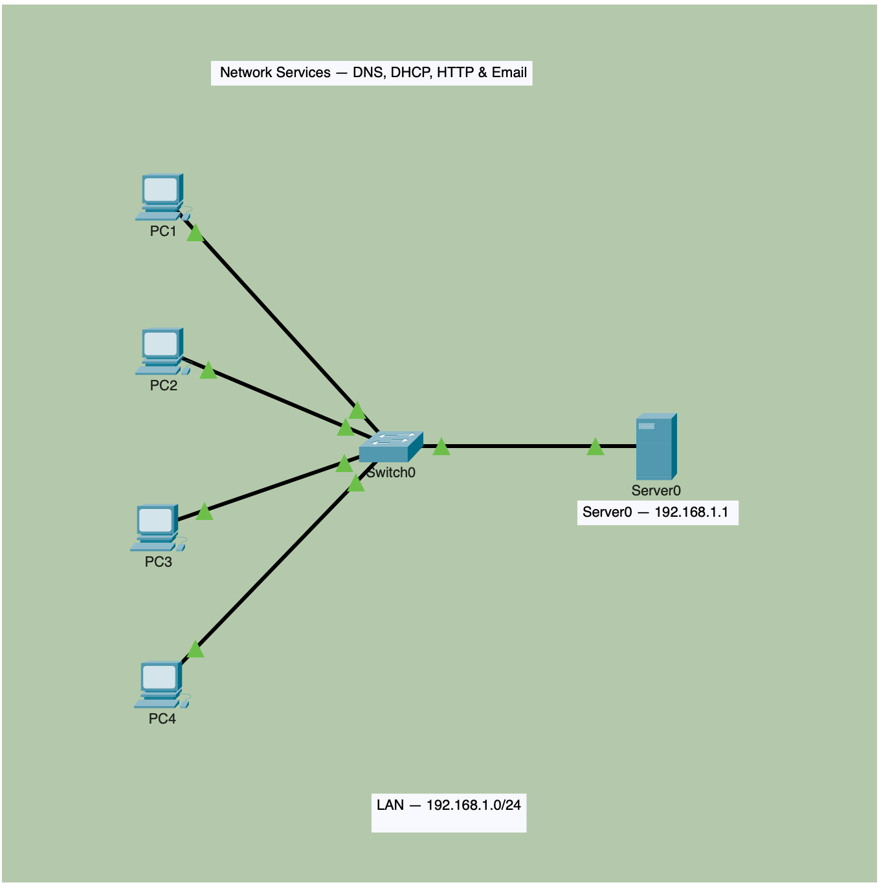

### Network Components

| Device | Quantity | Purpose |
|---|---|---|
| Server | 1 | Provides network services |
| Switch | 1 | Connects LAN devices |
| PC | 4 | Client devices |

The topology uses a star configuration in which all client devices and Server0 connect to Switch0.

### Network Addressing

| Network | Address | Purpose |
|---|---|---|
| LAN | 192.168.1.0/24 | Internal network |

### Server Configuration

| Parameter | Value |
|---|---|
| Device | Server0 |
| IPv4 Address | 192.168.1.1 |
| Subnet Mask | 255.255.255.0 |
| Default Gateway | 0.0.0.0 |
| DNS Server | 192.168.1.1 |
| Addressing Method | Static |

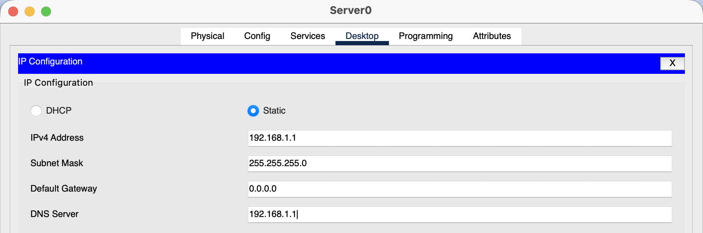

### PC Configuration

PC1 was initially configured with a static IPv4 address during connectivity testing.

| Parameter | Value |
|---|---|
| Device | PC1 |
| IPv4 Address | 192.168.1.2 |
| Subnet Mask | 255.255.255.0 |
| Default Gateway | 0.0.0.0 |
| DNS Server | 192.168.1.1 |
| Addressing Method | Static |

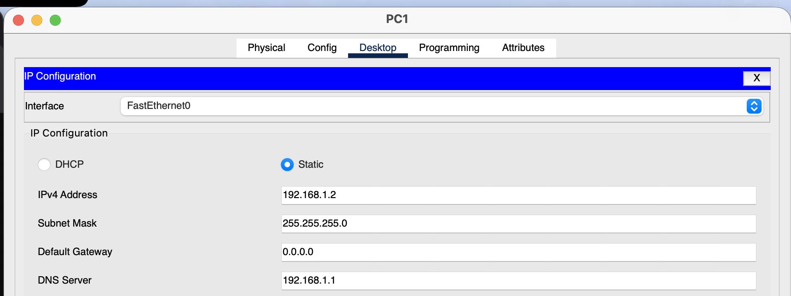

### DHCP Client Addressing

The following addresses were observed in the DHCP configuration screenshots.

| Device | IPv4 Address | Subnet Mask | DNS Server |
|---|---|---|---|
| PC1 | 192.168.1.2 | 255.255.255.0 | 192.168.1.1 |
| PC2 | 192.168.1.3 | 255.255.255.0 | 192.168.1.1 |
| PC3 | 192.168.1.4 | 255.255.255.0 | 192.168.1.1 |
| PC4 | 192.168.1.5 | 255.255.255.0 | 192.168.1.1 |

All four PCs are shown using DHCP in the corresponding verification screenshots.

The default gateway is `0.0.0.0` because no router is included in the demonstrated LAN topology.

---

## 3. Configuration

### Configuration Overview

The following services were configured on Server0:

- DHCP
- DNS
- HTTP/HTTPS
- SMTP
- POP3

### 3.1 DHCP Configuration

DHCP was enabled on Server0 to automatically provide IPv4 configuration to client devices.

**DHCP Pool Settings**

| Parameter | Value |
|---|---|
| Service | On |
| Pool Name | serverPool |
| Default Gateway | 0.0.0.0 |
| DNS Server | 192.168.1.1 |
| Starting IP Address | 192.168.1.2 |
| Subnet Mask | 255.255.255.0 |
| Maximum Number of Users | 254 |

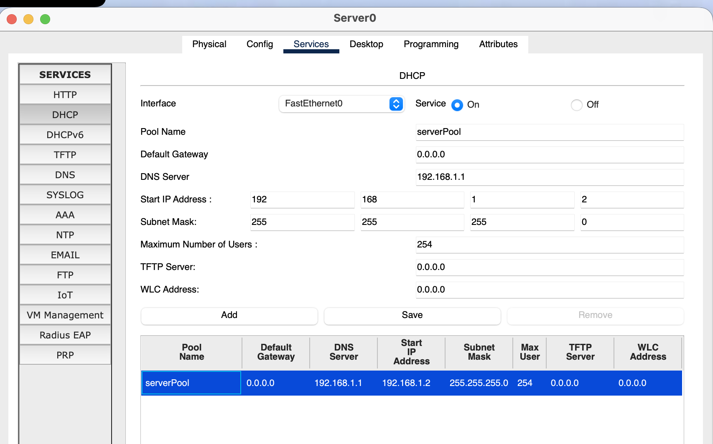

### DHCP Client Configuration

The client devices were configured to obtain their IPv4 settings automatically.

**PC1**

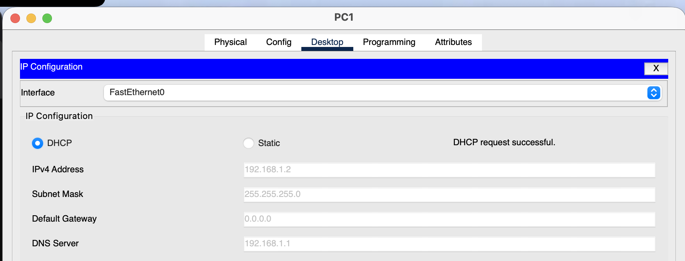

**PC2**

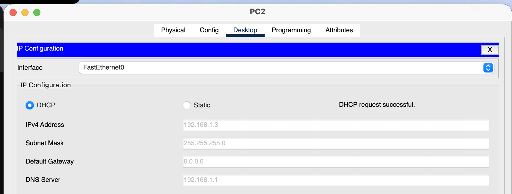

**PC3**

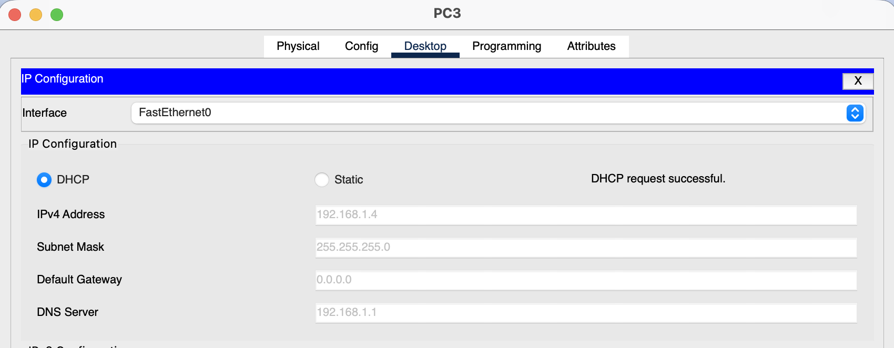

**PC4**

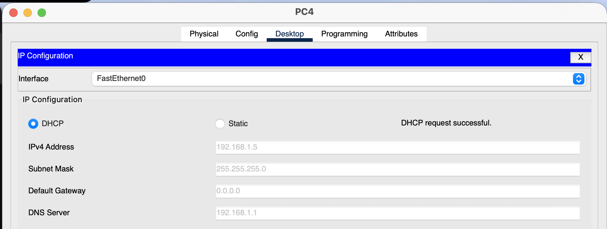

### 3.2 DNS Configuration

The DNS service was enabled to translate the configured domain name into the server's IPv4 address.

| Parameter | Value |
|---|---|
| DNS Service | On |
| Domain Name | computerscience.com |
| Record Type | A Record |
| IP Address | 192.168.1.1 |

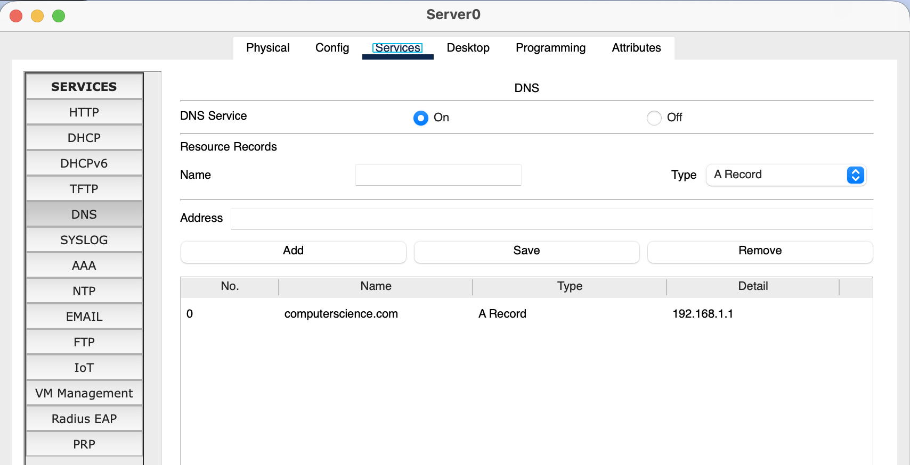

The A record maps `computerscience.com` to `192.168.1.1`.

### 3.3 HTTP & HTTPS Configuration

The web services were enabled on Server0.

| Service | Status |
|---|---|
| HTTP | On |
| HTTPS | On |

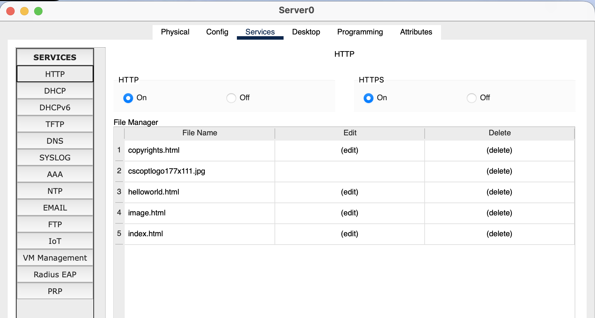

The server contains the default Cisco Packet Tracer web files, including `index.html`.

These files provide a webpage that clients can access through the web browser.

### 3.4 Email Configuration

Email services were configured on Server0 using SMTP and POP3.

| Parameter | Value |
|---|---|
| SMTP Service | On |
| POP3 Service | On |
| Domain Name | computerscience.com |

Four email accounts were configured:

| Username | Email Address |
|---|---|
| cs1 | cs1@computerscience.com |
| cs2 | cs2@computerscience.com |
| cs3 | cs3@computerscience.com |
| cs4 | cs4@computerscience.com |

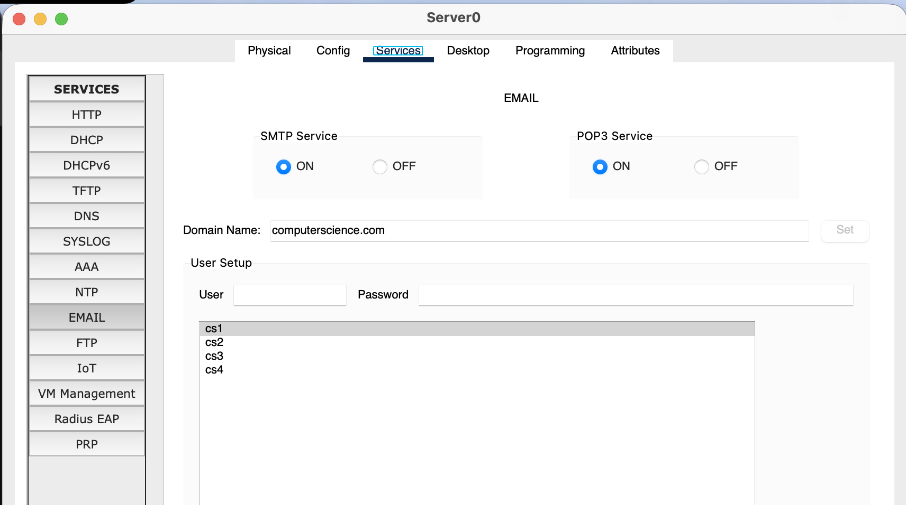

SMTP provides email transmission, while POP3 allows clients to retrieve messages from the mail server.

---

## 4. Verification & Results

### 4.1 DHCP Verification

The DHCP configuration was verified by checking the IPv4 settings assigned to client devices.

The screenshots confirm successful DHCP requests and valid IPv4 addresses within the configured LAN.

| Device | Assigned IPv4 Address | Result |
|---|---|---|
| PC1 | 192.168.1.2 | Passed |
| PC2 | 192.168.1.3 | Passed |
| PC3 | 192.168.1.4 | Passed |
| PC4 | 192.168.1.5 | Passed |

### 4.2 Network Connectivity Verification

ICMP ping was used to verify communication between client devices and Server0.

**Test 1 — PC1 to Server0**

```text
ping 192.168.1.1

Packets: Sent = 4, Received = 4, Lost = 0 (0% loss)
```

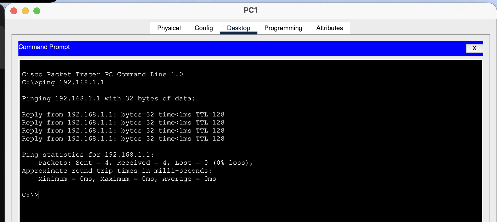

**Test 2 — PC4 to Server0**

```text
ping 192.168.1.1

Packets: Sent = 4, Received = 4, Lost = 0 (0% loss)
```

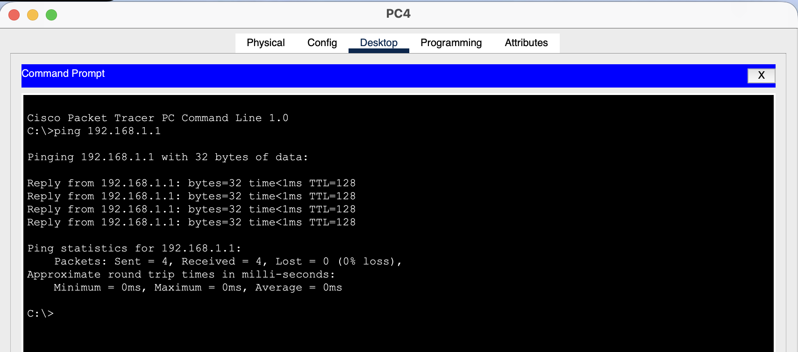

Both tests returned four successful replies with no packet loss.

### 4.3 DNS Resolution Verification

DNS functionality was tested by using the configured domain name instead of the server's IPv4 address.

**Test — PC1 to computerscience.com**

```text
ping computerscience.com

Resolved IP Address: 192.168.1.1

Packets: Sent = 4, Received = 4, Lost = 0 (0% loss)
```

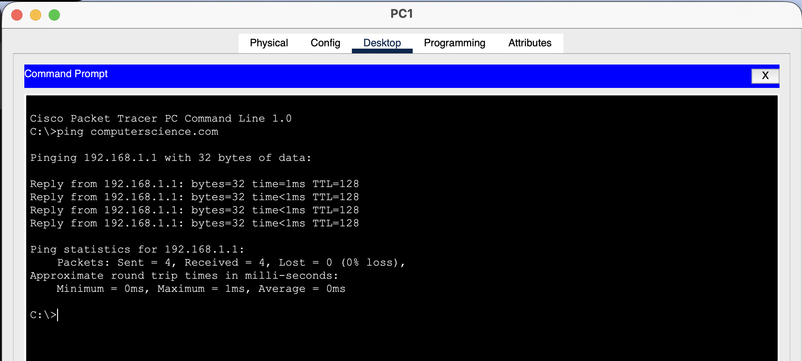

The result confirmed that `computerscience.com` resolved to `192.168.1.1` and that the destination was reachable.

### 4.4 HTTP Verification

Web access was tested from PC1 using two methods.

**Test 1 — Access Using IPv4 Address**

```text
http://192.168.1.1
```

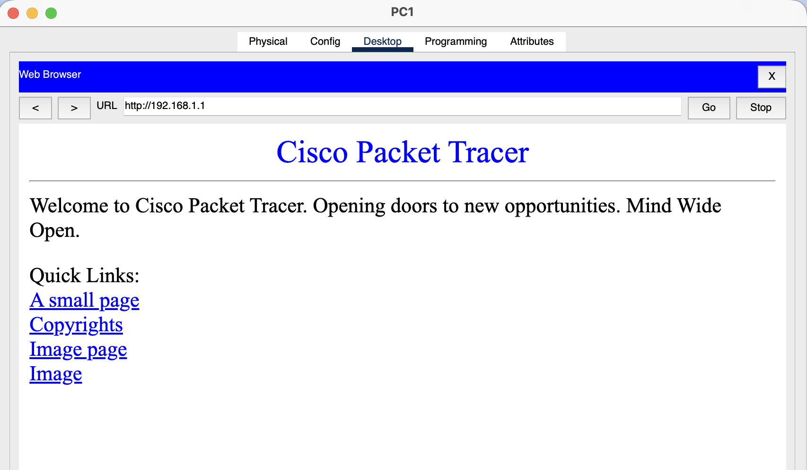

**Test 2 — Access Using Domain Name**

```text
http://computerscience.com
```

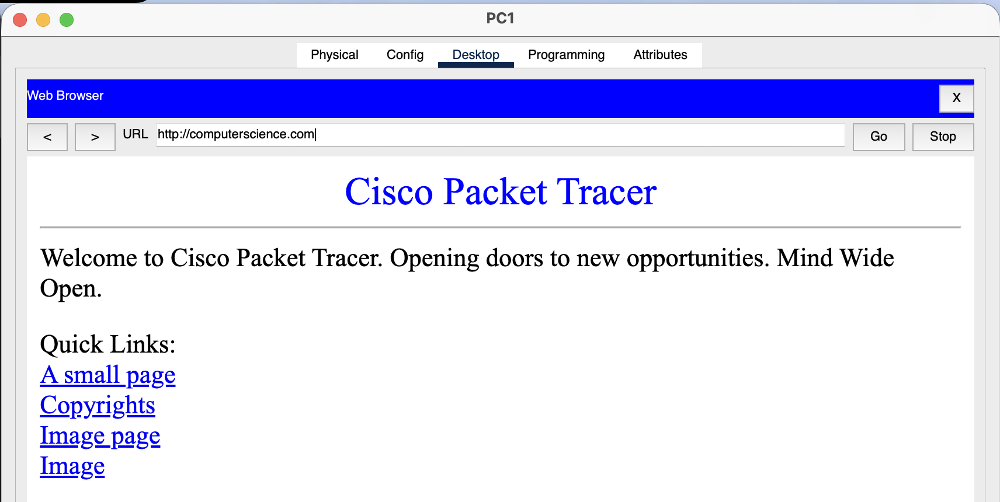

Both tests successfully displayed the Cisco Packet Tracer webpage.

This confirmed HTTP accessibility through both direct IP addressing and DNS-based name resolution.

### 4.5 Email Verification

Email functionality was tested by sending a message from PC1 to PC2.

**Test 1 — Email Transmission**

| Parameter | Value |
|---|---|
| Sender | cs1@computerscience.com |
| Recipient | cs2@computerscience.com |
| Subject | Lab 03 - Email Test |
| Result | Send Success |


The mail client displayed `Send Success`, confirming successful email submission to the configured mail server.

**Test 2 — Email Reception**

PC2 retrieved the message sent from PC1.

The received message contained the expected sender, subject, and message content.

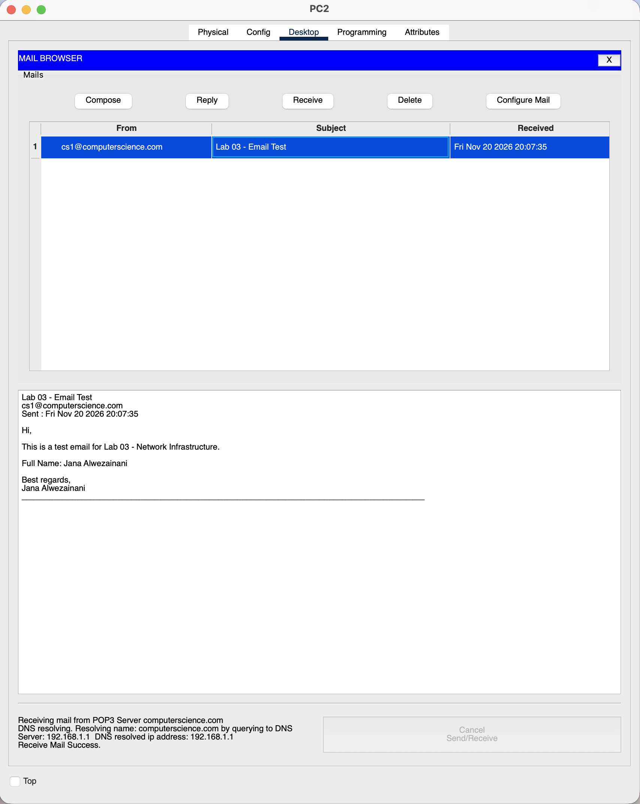

The mail client displayed `Receive Mail Success`, confirming successful message retrieval through POP3.

### Verification Summary

| Verification Test | Result |
|---|---|
| DHCP address assignment | Passed |
| PC1 to Server0 connectivity | Passed — 0% packet loss |
| PC4 to Server0 connectivity | Passed — 0% packet loss |
| DNS name resolution | Passed |
| HTTP access using IP address | Passed |
| HTTP access using domain name | Passed |
| SMTP email transmission | Passed |
| POP3 email reception | Passed |

**Note:** HTTPS was enabled in the server configuration, but a separate HTTPS browser access test is not included in the available screenshots.

---

## 5. Troubleshooting

### Observation 1 — Static and Dynamic IP Configuration

**Observation:** PC1 was initially configured with a static IPv4 address and was later shown using DHCP.

**Explanation:** The screenshots document different configuration stages.

**Result:** PC1 successfully obtained an IPv4 configuration through DHCP in the later verification screenshot.

### Observation 2 — DHCP Address Changes

**Observation:** One earlier screenshot shows PC3 with `192.168.1.3`, while a later screenshot shows `192.168.1.4`.

**Explanation:** The screenshots capture different DHCP assignment states. The precise reason for the address change was not independently established.

**Documentation Decision:** The later DHCP screenshot is used to represent the documented final address for PC3.

### Troubleshooting Outcome

The available evidence shows successful connectivity, DHCP address assignment, DNS resolution, HTTP access, and email communication.

No unresolved service failure is demonstrated in the final verification screenshots.

---

## 6. Lessons Learned

This lab provided practical experience in the following areas:

### Network Configuration

- Configuring static IPv4 addresses.
- Understanding subnet masks and default gateways.
- Connecting multiple end devices through a LAN switch.
- Verifying local network connectivity.

### DHCP Services

- Configuring a DHCP address pool.
- Understanding dynamic IP allocation.
- Assigning DNS server information through DHCP.
- Verifying client address assignment.

### DNS Services

- Configuring DNS A records.
- Understanding hostname-to-IP address resolution.
- Testing DNS functionality through domain-based ping commands.
- Understanding the role of DNS in accessing network applications.

### Web Services

- Enabling HTTP and HTTPS services.
- Accessing web resources through IPv4 addresses.
- Accessing web resources through domain names.
- Understanding the relationship between DNS and HTTP.

### Email Services

- Configuring SMTP and POP3 services.
- Creating email user accounts.
- Sending email between client devices.
- Retrieving email from a mail server.
- Verifying successful email transmission and reception.

### Verification & Technical Documentation

- Using ICMP ping for connectivity testing.
- Interpreting DHCP assignment results.
- Verifying DNS resolution.
- Testing web and email applications.
- Organizing configuration screenshots.
- Documenting network service implementations for a GitHub portfolio.

---

## 7. Conclusion

The lab demonstrated the configuration and verification of essential network services in Cisco Packet Tracer.

Server0 was configured to provide DHCP, DNS, HTTP/HTTPS, and email services to client devices within the `192.168.1.0/24` LAN.

The verification results confirmed successful DHCP address assignment, DNS resolution, HTTP access, and SMTP/POP3 email communication.

ICMP connectivity tests also demonstrated successful communication between the tested client devices and Server0, with 0% packet loss.

The lab illustrates how centralized network services support automatic addressing, domain name resolution, web access, and electronic communication within a local network.

---

## 8. Project File

[Open Cisco Packet Tracer Configuration](./configuration.pkt)
