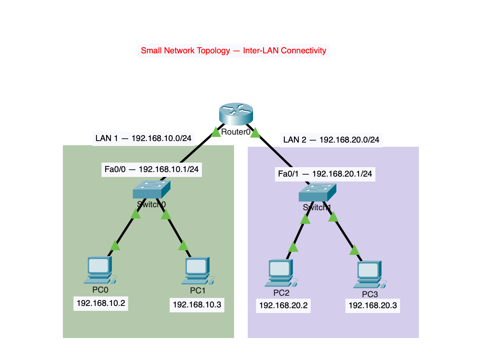
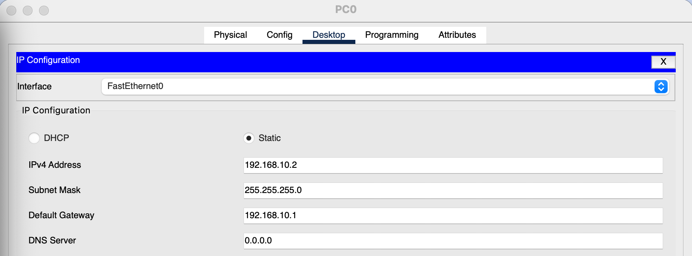
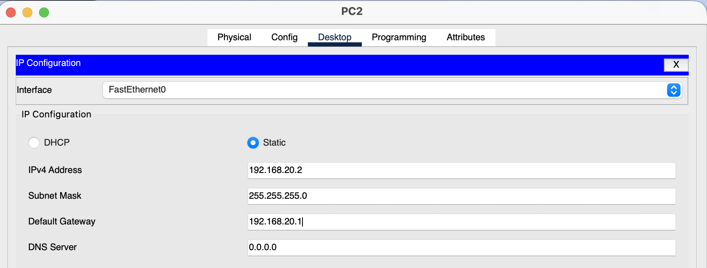
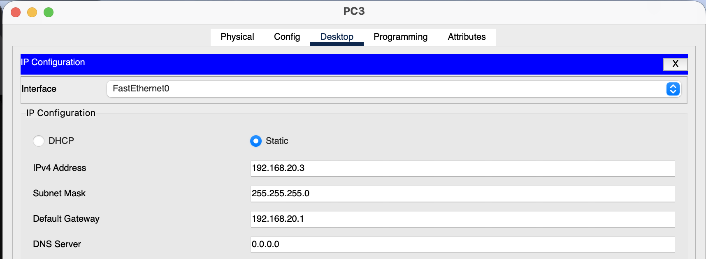
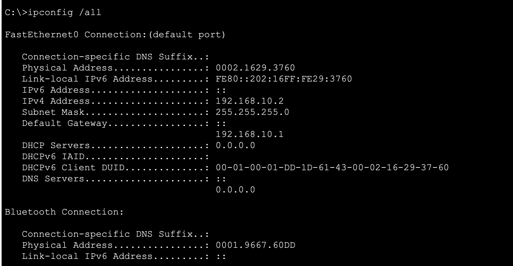
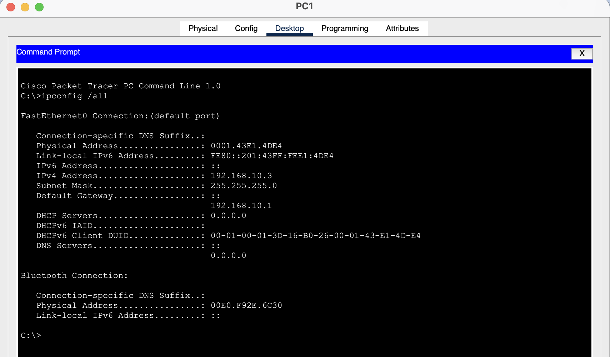
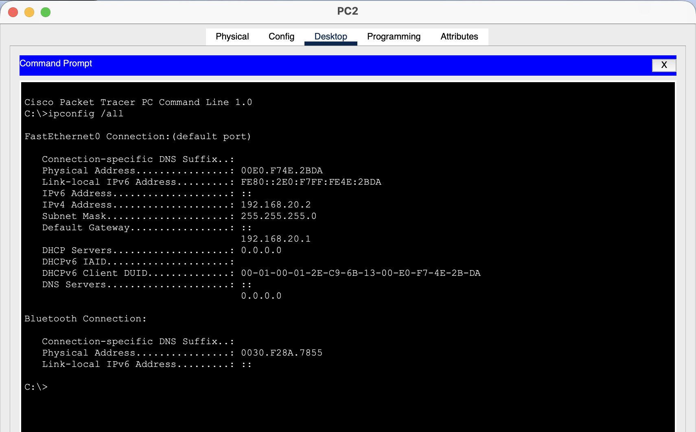
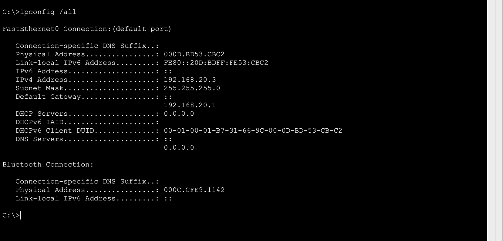
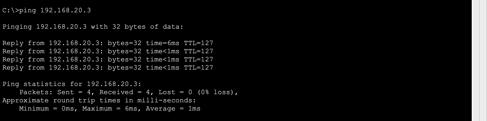
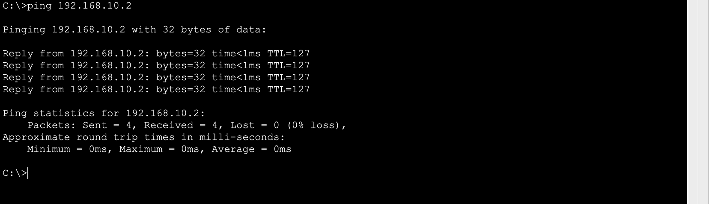

# Lab 04 — Small Network Topology & Inter-LAN Connectivity

## 1. Objective & Problem Statement

### Objective

Configure and verify communication between two IPv4 LANs connected by a Cisco router using Cisco Packet Tracer.

This lab demonstrates static IPv4 addressing, default gateway configuration, router interface activation, and bidirectional ICMP connectivity testing.

### Problem Statement

Two separate LANs contain four PCs. Hosts on different IP subnets cannot communicate through their switches alone; a Layer 3 device is needed to forward packets between the networks.

**The challenge:** Enable PC0 on LAN 1 to communicate with PC3 on LAN 2, and verify connectivity in the reverse direction.

### Proposed Solution

Connect both LANs to Router0, configure one FastEthernet interface in each subnet, and assign each PC an IPv4 address, subnet mask, and corresponding default gateway. Verify connectivity using ICMP ping.

### Lab Objectives

- Build two switched LANs connected to one router.
- Configure static IPv4 addressing on four PCs.
- Configure and activate two router interfaces.
- Verify interface status.
- Test communication between PC0 and PC3 in both directions.

---

## 2. Network Topology & IP Addressing

### Network Topology



### Network Components

| Device | Quantity | Purpose |
|---|---:|---|
| Router | 1 | Routes traffic between the two LANs |
| Switch | 2 | Connects hosts within each LAN |
| PC | 4 | End devices for connectivity testing |

### Network Addressing

| Network | Network Address | Router Interface | Default Gateway |
|---|---|---|---|
| LAN 1 | 192.168.10.0/24 | FastEthernet0/0 | 192.168.10.1 |
| LAN 2 | 192.168.20.0/24 | FastEthernet0/1 | 192.168.20.1 |

### PC Configuration

| Device | IPv4 Address | Subnet Mask | Default Gateway |
|---|---|---|---|
| PC0 | 192.168.10.2 | 255.255.255.0 | 192.168.10.1 |
| PC1 | 192.168.10.3 | 255.255.255.0 | 192.168.10.1 |
| PC2 | 192.168.20.2 | 255.255.255.0 | 192.168.20.1 |
| PC3 | 192.168.20.3 | 255.255.255.0 | 192.168.20.1 |

---

## 3. Configuration

### Configuration Overview

The router provides a directly connected route to each LAN. No dynamic routing protocol or static route is required for communication between these two directly connected networks.

### Router0 — Interface Configuration

```text
enable
configure terminal
interface FastEthernet0/0
 ip address 192.168.10.1 255.255.255.0
 description Connection to West LAN
 no shutdown
interface FastEthernet0/1
 ip address 192.168.20.1 255.255.255.0
 description Connection to East LAN
 no shutdown
end
show ip interface brief
```

The router console screenshot records the interface configuration and the subsequent interface status check.


### PC — Static IPv4 Configuration

The PCs use static IPv4 settings. Each host's default gateway points to the router interface on its own LAN.

**PC1**



**PC2**



**PC3**



The PC0 address and gateway are verified in the `ipconfig /all` evidence below.

---

## 4. Verification & Results

### 4.1 Router Interface Status

The `show ip interface brief` output shows both configured router interfaces operational:

| Interface | IPv4 Address | Status | Protocol |
|---|---|---|---|
| FastEthernet0/0 | 192.168.10.1 | up | up |
| FastEthernet0/1 | 192.168.20.1 | up | up |

### 4.2 PC IPv4 Verification

The `ipconfig /all` command was used to inspect each PC's IPv4 address, subnet mask, and default gateway.

**PC0**



**PC1**



**PC2**



**PC3**



### 4.3 Inter-LAN Connectivity Testing

**Test 1 — PC0 to PC3**

From PC0, test connectivity to PC3 on the other subnet:

```text
ping 192.168.20.3
Packets: Sent = 4, Received = 4, Lost = 0 (0% loss)
```



**Test 2 — PC3 to PC0**

From PC3, test connectivity to PC0 on the other subnet:

```text
ping 192.168.10.2
Packets: Sent = 4, Received = 4, Lost = 0 (0% loss)
```



### Verification Summary

| Verification Test | Result |
|---|---|
| Router FastEthernet0/0 | Passed — up/up |
| Router FastEthernet0/1 | Passed — up/up |
| PC IPv4 addressing and gateways | Verified |
| PC0 → PC3 connectivity | Passed — 0% packet loss |
| PC3 → PC0 connectivity | Passed — 0% packet loss |

---

## 5. Troubleshooting

### Configuration Checks

The final screenshots do not document an unresolved connectivity failure. Verification focused on checking the addressing and router interfaces before confirming end-to-end communication.

- Confirmed that each PC belongs to the intended `/24` subnet.
- Confirmed that each PC uses the router's local LAN interface as its default gateway.
- Confirmed that both router interfaces were enabled and reported `up/up`.
- Tested traffic in both directions between the two LANs.

### Troubleshooting Outcome

The recorded final ping tests returned four replies out of four in both directions. No remaining connectivity issue is demonstrated by the final evidence.

---

## 6. Lessons Learned

### Network Design & Addressing

- Dividing a small network into two IPv4 subnets.
- Connecting hosts through switches and a router.
- Assigning static IPv4 addresses, subnet masks, and default gateways.

### Router Configuration

- Configuring Cisco FastEthernet interfaces through the IOS CLI.
- Activating interfaces using `no shutdown`.
- Understanding how a router forwards traffic between directly connected networks.

### Verification & Documentation

- Checking router status with `show ip interface brief`.
- Inspecting host addressing with `ipconfig /all`.
- Testing bidirectional connectivity with ICMP ping.
- Recording screenshots and organizing a reproducible Packet Tracer lab for GitHub.

---

## 7. Conclusion

Two LANs were interconnected through Router0 in Cisco Packet Tracer. Router interfaces were configured in the `192.168.10.0/24` and `192.168.20.0/24` networks and verified as `up/up`.

The final ping tests confirmed communication from PC0 to PC3 and from PC3 to PC0, with 0% packet loss in both directions. The lab demonstrates basic inter-LAN routing using directly connected networks.

---

## 8. Project File

[Open Cisco Packet Tracer Configuration](./configuration.pkt)

